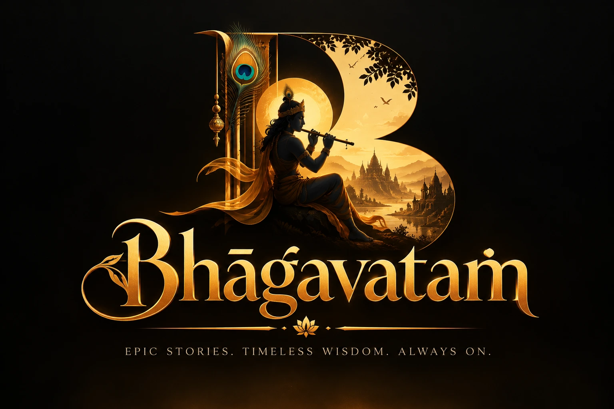
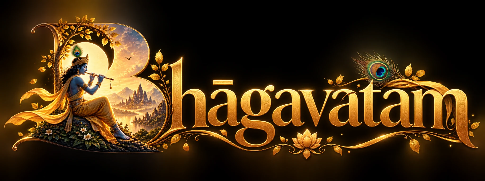
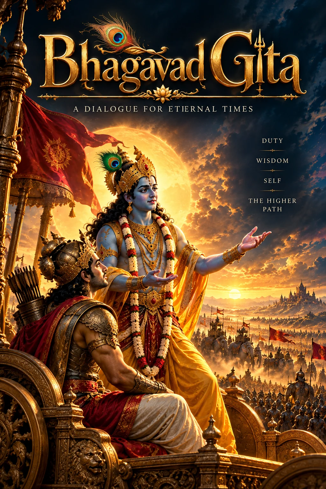
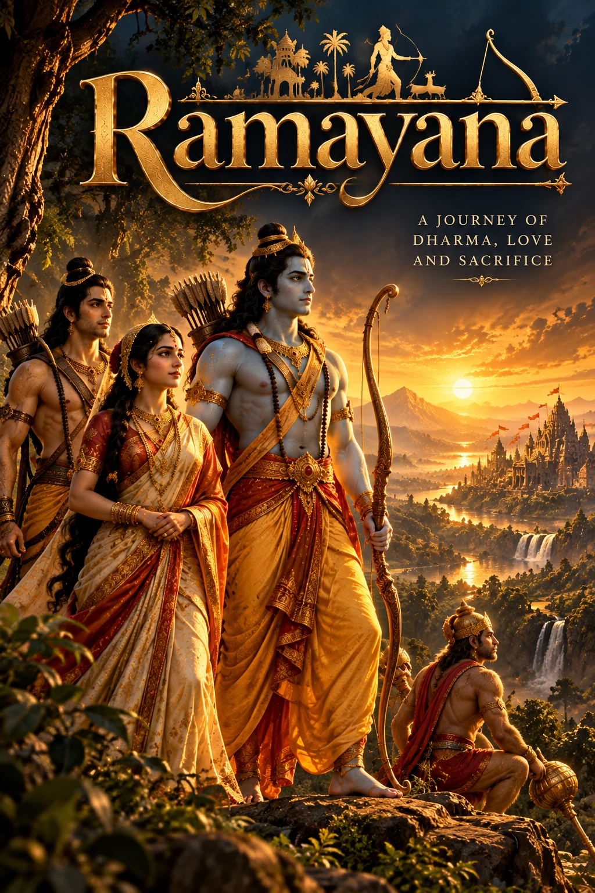
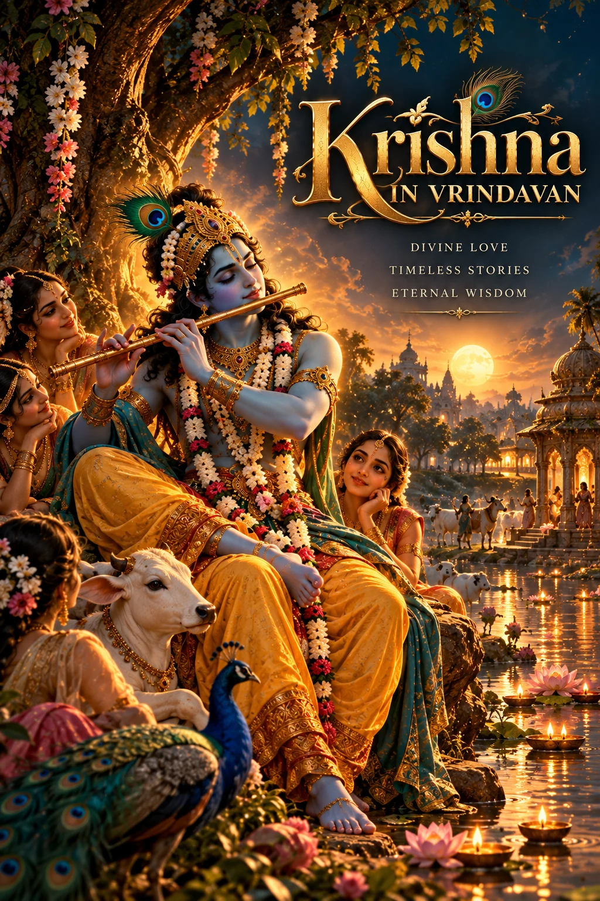
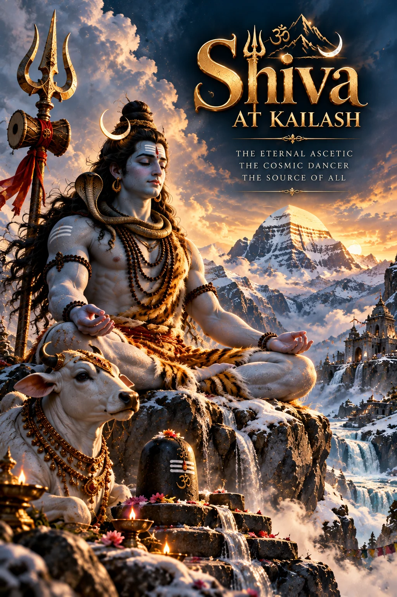
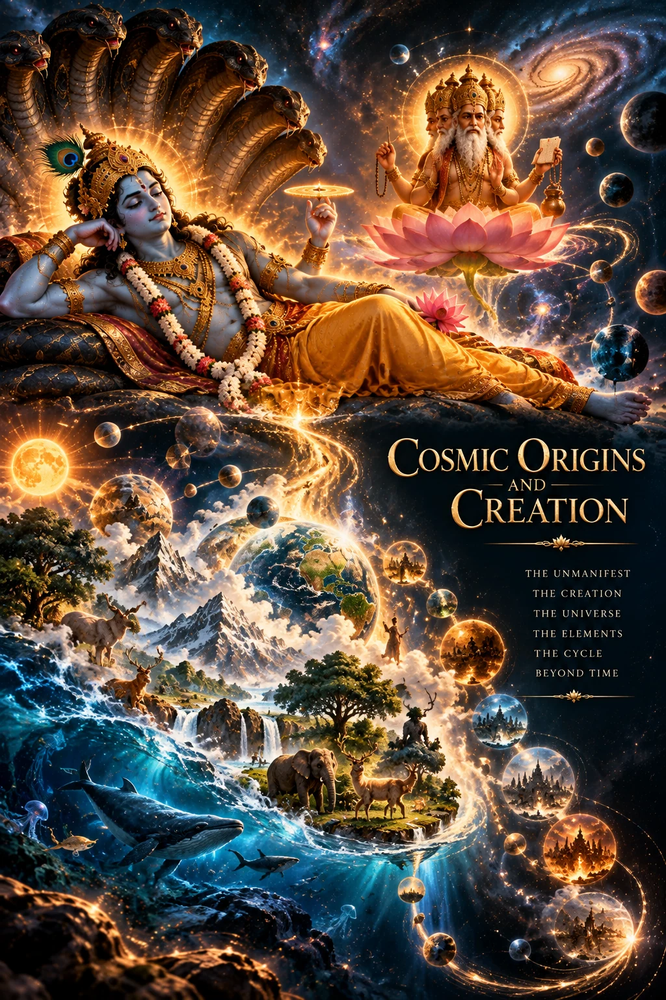

<div align="center">



# ✦ BHAAGAVATAM ✦
### An Infinite Universe of Stories, Wisdom & Wonder

**Ancient Indian narratives. A new way to experience them.**

*Read the legends · Listen to the wisdom · Watch the epics*



  

</div>

---

## ✦ The Universe

**Bhaagavatam** is a cinematic digital storytelling platform exploring Indian mythology, epics, scriptures, philosophy, and timeless stories. Inspired by premium streaming experiences, it brings narratives to life through three complementary formats.

| 📖 Read | 🎧 Listen | 🎬 Watch |
|:---:|:---:|:---:|
| Immersive chapters | Narrated stories | Cinematic storytelling |
| Discover at your pace | Hear every journey | Experience every scene |

*These are planned platform experiences; individual features and media may still be in development.*

## ✦ Featured Stories

<table>
<tr>
<td align="center" width="50%"><b>BHAGAVAD GITA</b><br/><sub>The eternal dialogue</sub></td>
<td align="center" width="50%"><b>RAMAYANA</b><br/><sub>A journey of dharma</sub></td>
</tr>
<tr>
<td align="center"><b>KRISHNA'S JOURNEY</b><br/><sub>Devotion, wonder & discovery</sub></td>
<td align="center"><b>SHIVA</b><br/><sub>The eternal ascetic</sub></td>
</tr>
</table>

## ✦ Book One: Cosmic Origins



**42 planned episodes** tracing the emergence of the cosmos, the cycles of creation, and the stories that shape a universe.

## ✦ Discover 17 Story Collections

| | |
|---|---|
| Short Stories | Individual Divine Journeys |
| Great Epics & Sagas | Cosmic Origins |
| Avatars & Incarnations | Divine Battles |
| Rishis, Sages & Wisdom | Goddesses & Shakti |
| Devotion & Miracles | Love, Family & Relationships |
| Curses, Boons & Destiny | Kings, Queens & Kingdoms |
| Sacred Places & Stories | Festivals & Origins |
| Moral Tales & Wisdom | Lesser-Known Legends |
| **Vedas** | |

Stories are organized with a primary collection and cross-references to related collections.

## ✦ Design Language


**Charcoal black · Antique gold · Editorial typography · Cinematic Indian epic art**

The experience is designed around atmospheric artwork, accessible storytelling, respectful depictions, and intuitive exploration. English and Roman Hinglish are part of the content vision.

## ✦ Tech & Setup

The primary frontend is a **React + Vite** application.

```bash
git clone https://github.com/vruddhiZaveri/Bhaagavatam.git
cd Bhaagavatam/bhaagavatam-frontend
npm install
npm run dev
```

Build:

```bash
npm run build
```

## ✦ Project Layout

```text
Bhaagavatam/
├── bhaagavatam-frontend/
│   ├── public/art/        # Posters and illustrations
│   ├── public/branding/   # Logos
│   ├── src/               # React UI
│   ├── content/           # Story content
│   └── catalogues/        # Production planning
├── Assets/                # Source artwork
└── README.md
```

## ✦ Roadmap

- [x] Establish cinematic visual direction and brand
- [x] Plan story discovery collections
- [x] Assemble initial poster and illustration library
- [x] Outline Cosmic Origins: Book One
- [ ] Verify frontend routes and responsive layouts
- [ ] Complete Read, Listen and Watch journeys
- [ ] Integrate multilingual content and progress tracking
- [ ] Audit image mapping, cropping, accessibility and performance

---

<div align="center">


### ✦ Every Story Is a Universe ✦

*Preserving timeless narratives through contemporary storytelling.*

</div>
